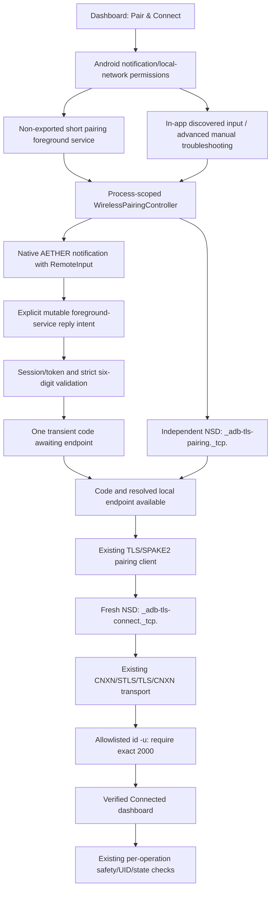

# AETHER notification pairing redesign

**Current follow-up:** see [POCO F6 / HyperOS discovery failure](#poco-f6--hyperos-discovery-failure-follow-up) for the reported real-device failure, confirmed source defects, asynchronous-flow repair and updated validation. The original redesign results below are a historical baseline.

## Scope and evidence boundary

This continues the previous 47-observation/43-repair audit in the existing single-module application. The starting working tree already contained 105 hardening paths; those changes and the untracked user AGENTS.md are preserved. Branch `main`, HEAD `ca653dd` and published history remain unchanged. No commit, push, workflow submission or release publication was performed.

The notification architecture is implemented locally. Production acceptance remains conditional on Android NSD/SystemUI/keystore/adbd and physical-device validation. The user reports a discovery failure on POCO F6 / HyperOS; a subsequent user-supplied POCO F6 / Android 16 / HyperOS trace now verifies end-to-end pairing, transport and shell UID 2000. **Hardware validation still pending** for other devices and lifecycle scenarios; production release acceptance also needs the remaining security/signing gates.

## Official reference investigation (before implementation)

Read-only reference checkout: RikkaApps/Shizuku commit `b844bc491f1790c72328e1a8e5b2349f8978f0ea`. The root LICENSE is Apache-2.0. Inspected:

- [AdbPairingService.kt](https://github.com/RikkaApps/Shizuku/blob/b844bc491f1790c72328e1a8e5b2349f8978f0ea/manager/src/main/java/moe/shizuku/manager/adb/AdbPairingService.kt): foreground promotion, mutable explicit reply PendingIntent, native RemoteInput, immutable stop/retry intents, discovery and result notifications.
- [AdbPairingTutorialActivity.kt](https://github.com/RikkaApps/Shizuku/blob/b844bc491f1790c72328e1a8e5b2349f8978f0ea/manager/src/main/java/moe/shizuku/manager/adb/AdbPairingTutorialActivity.kt): notification enablement/channel checks, developer-settings navigation and foreground-start failure.
- [AdbMdns.kt](https://github.com/RikkaApps/Shizuku/blob/b844bc491f1790c72328e1a8e5b2349f8978f0ea/manager/src/main/java/moe/shizuku/manager/adb/AdbMdns.kt): separate ADB pairing/connect types, NSD resolution/loss, local-interface address filtering.
- [AdbPairingClient.kt](https://github.com/RikkaApps/Shizuku/blob/b844bc491f1790c72328e1a8e5b2349f8978f0ea/manager/src/main/java/moe/shizuku/manager/adb/AdbPairingClient.kt): TLS exporter/code binding, SPAKE2 native context, pairing framing/peer-info and cleanup.
- [AdbKey.kt](https://github.com/RikkaApps/Shizuku/blob/b844bc491f1790c72328e1a8e5b2349f8978f0ea/manager/src/main/java/moe/shizuku/manager/adb/AdbKey.kt): PreferenceAdbKeyStore, keystore-encrypted identity, certificate/key managers and AOSP RSA encoding.
- [Official setup guide](https://shizuku.rikka.app/guide/setup/): notification code entry on Android 11+, explicit start after pairing in Shizuku, mDNS/background and manufacturer reports.
- [Android local-network permission guidance](https://developer.android.com/privacy-and-security/local-network-permission): ACCESS_LOCAL_NETWORK is runtime-enforced for SDK 37 applications on Android 17.

AETHER implementation is independent. No Shizuku source, assets, key store, native library, identity or branding is incorporated. It uses AndroidX notification APIs already on its resolved classpath. No new runtime dependency or library update was required. Shizuku’s GlobalScope/intent-redelivery behavior was not adopted: AETHER uses scoped jobs and START_NOT_STICKY so pairing-code payloads cannot be replayed.

Repository-mandated codebase-memory skill remains unavailable. Structural inspection used installed token-saver skeleton/symbol/ranged-read tools. Its Compose reference index missed known call sites; bounded direct reference checks covered those misses.

## Previous architecture

Dashboard → manual setup → host + pairing port → in-app six-box code dialog → pair. A separate manual connection-port action opened ADB. The old unused discovery scaffolding had been removed during hardening. Pairing/transport already used the same AndroidKeyStore RSA-PSS identity and the repaired real protocol; those components are reused.

## New architecture and state ownership



`WirelessPairingState` represents phase, real pairing result, independently verified transport, shell UID, endpoints, last successful connection time and actionable feedback. Legal transitions and capability invariants reject direct search/pairing → Connected shortcuts. Start/submit guards prevent competing sessions/replies. A session and each eligible endpoint get fresh random reply tokens. No secret lives in state, saved state, preferences, diagnostics or notification extras owned by the controller.

Dashboard’s initial primary action is PAIR & CONNECT. Active/ready sessions expose Connection details so users can still open the guide and cancel/disconnect. Guide and onboarding describe notification input; normal setup contains no IP/port fields. Manual fields/dialog are retained under advanced settings and real manual pairing success updates authentication metadata without asserting transport/shell readiness. Existing package, recovery, history, persistence, design-system and CI protections remain in place.

## RemoteInput and PendingIntent security

AetherPairingNotifications uses NotificationCompat, NotificationChannel, NotificationManagerCompat and native RemoteInput. The field is labelled Wi-Fi pairing code, with PAIR action. SystemUI controls the keyboard; no portable RemoteInput inputType setting exists. Exactly six ASCII digits, including leading zeroes, are accepted. Empty/malformed/stale/duplicate replies do not dispatch authentication.

The reply PendingIntent is mutable because SystemUI must attach RemoteInput results, with an explicit non-exported service component/package and unique session/token Intent identity. Other actions/content/delete intents are immutable. Reply actions request authentication, notifications are private on the lock screen, and obsolete reply PendingIntents are revoked when notification state changes. The service directly consumes results and clears the Intent clip payload/extras; there is no exported receiver, notification-listener permission or activity trampoline. Codes are never persisted or redelivered. The mutable copied code buffer is wiped after protocol use or Channel cancellation before delivery; immutable JVM strings and SystemUI’s own input cannot be securely zeroed.

Notifications reflect searching, service found, pairing, pairing success, connect discovery, transport, shell verification, connected or actionable failure. Success content originates from protocol and UID results, never a timer or demonstration state.

## Foreground service, permissions and process lifecycle

The service starts from a visible user action and promotes immediately, including stale foreground-intent deliveries. Manifest declares FOREGROUND_SERVICE, POST_NOTIFICATIONS and ACCESS_LOCAL_NETWORK with an explicit non-exported shortService. API 34+ uses the shortService type; older APIs use normal foreground promotion. The controller has a 150-second session deadline, below the platform short-service limit, and handles platform onTimeout. Discovery stops after terminal success/failure/cancellation; foreground notification is updated/detached and the service stops. Connected completion notifications state verification in the past tense and expire after eight seconds; they do not claim an indefinitely maintained background session. Service stop requests use the latest start ID and cleanup is bound to the owned session so an old lifecycle callback cannot cancel a newer flow.

Notification permission/channel denial is explained and offers Android settings plus discovered in-app input. ACCESS_LOCAL_NETWORK is separately requested on SDK 37 devices; denial cannot be bypassed by manual setup. Permission callbacks are owned by the NavHost to survive navigation away from Dashboard. Android/OEM foreground-start rejection gives explicit fallback guidance.

START_NOT_STICKY, session tokens and service ownership reject stale replies after process/service recreation. Service destruction cancels unfinished work. Process death loses sockets/session and requires an explicit reconnect; submitted codes and package mutations are never replayed. This is a pairing foreground service, not an indefinite foreground shell process. After success, shell ownership remains process-scoped; keep AETHER open for package operations.

## Discovery and network behavior

Event-driven Android NSD discovers the separate pairing and connection service types. API 34+ uses continuous ServiceInfoCallback updates; API 30–33 serializes legacy resolution and waits for an outstanding OS callback before starting another resolve after cancellation. Synchronous platform resolve rejection completes that queue entry so later retries cannot hang behind it. Each collection owns listeners/callbacks and removes them on completion/cancellation. Advertisements and registrations are bounded to 32 services. Only local-interface/loopback addresses and valid ports become endpoints; numeric IPv6 and scoped local addresses are supported by host validation.

DiscoveryLease guards asynchronous validation against service loss, re-registration and out-of-order address completion. Lost pairing services clear reply tokens and cancel obsolete authentication; lost connection endpoints cancel obsolete verification. Wi-Fi loss invalidates endpoints and returns recovery; a fresh user retry starts a new NSD session. There is no network polling or persisted endpoint reuse in normal flow. The system pairing dialog must be open for the temporary service to exist.

## Protocol, connection and shell findings

Existing TlsPairingClient, TLS exporter/SPAKE2/peer-info, persistent AndroidAdbKeyStore identity and AdbConnectionManager/AdbSession framing are preserved. Pairing success requires actual decrypted peer info. Fresh connect discovery follows pairing; reconnect can use the retained identity without asking for a code. Authenticated transport must succeed before allowlisted `id -u`. Exact UID 2000 and an active transport are required for Connected, including a second transport check after suspending preference writes. Transport loss removes the ready state.

No Shizuku Binder API, root service or external installation is introduced. Shell execution uses AETHER’s existing structured command allowlist, output buffering, cancellation, timeout and disconnect behavior. Classic shell output does not expose a separate shell-v2 exit-status channel; package operations continue to require expected output plus resulting state. UID 2000 does not guarantee every OEM permits every pm mutation; each operation independently verifies privileges/results and reports failure.

## Manufacturer compatibility and outstanding review

No devices tested: stock Android, MIUI, HyperOS, Samsung One UI, ColorOS and OxygenOS are all pending. Upstream guide reports about MIUI notification styling and invisible-app network restrictions are reference observations only. No brand-gated behavior, silent permission activation or security-setting bypass is implemented. Notification/channel checks, settings recovery and discovered/manual fallbacks handle capabilities explicitly.

The previous variable-time BigInteger SPAKE2 implementation and local-listener trust assumption still require independent crypto/security review. Real AndroidKeyStore RSA-PSS/Conscrypt/adbd interoperability, SystemUI reply behavior, mDNS delivery, background/service termination and safe disposable-package/OEM testing remain release gates.

## Significant corrections and regression evidence

| Problem / root cause | Correction | Verification |
|---|---|---|
| Old normal flow required both ephemeral ports and manual code entry | Native notification flow, independent NSD pairing/connect sessions; retain manual advanced fallback | Controller/Compose fixtures; real SystemUI execution pending |
| SDK 37 NSD/socket access needs runtime local-network authorization | Manifest/runtime permission and settings guidance; no silent fallback bypass | SDK/API docs, compilation/lint and permission-state fixtures |
| Repeated replies could start concurrent authentication; old notifications could target new ports | Synchronous phase transition, session/generation tokens and revoked old reply intents | Duplicate, malformed, restart and stale-token tests; Android PendingIntent tests compiled |
| Delayed NSD address checks could resurrect a lost/outdated endpoint | DiscoveryLease revision/identity checks; cancel lost-service pairing/verification | Production lease tests plus service-loss controller regressions |
| Transport establishment alone was an insufficient connected signal | Independent exact `id -u` == 2000 check and gated ViewModel/dashboard state | Wrong UID, partial/error output, failed exec and socket integration tests |
| Transport could fail during suspended preference persistence | Recheck active transport after persistence before Connected | Dedicated transport-loss-during-persistence regression |
| Recreated service could receive a stale reply and retain an orphan foreground notification | Service ownership check, foreground deadline handling, START_NOT_STICKY and rejection | Process-recreation/controller tests; Android lifecycle validation pending |
| NSD can return IPv6, previously rejected by host validation | Numeric IPv6/scoped-address validation without DNS lookup | IPv6/malformed-host regressions; device IPv6 behavior pending |
| Manual fallback could race the automatic session or fail to update dashboard capabilities | Shared controller for manual connection, real pairing-result metadata and active-session guards | Manual connection/authentication/capability and conflict regressions |
| Cancelled Channel delivery could discard a copied code before protocol cleanup | onUndeliveredElement clears mutable input when cancellation wins | Queued-reply cancellation regression; no dispatch after cancellation |
| Synchronous legacy NSD resolve rejection could leave the next session awaiting an incomplete queue entry | Complete the entry before propagating rejection | Compilation/lint; real Android platform rejection remains device-test pending |
| Two cancel requests could close a new session and cause PREPARING → DISCONNECTED failure | Serialize cancellation and bind queued cancel requests to the original session ID | Focused test reproduced IllegalStateException before repair; persistent race regression |
| Successful advanced pairing left an obsolete failure phase/message | Clear terminal failure into an authenticated idle state without claiming shell readiness | Focused test reproduced PAIRING_FAILED instead of IDLE before repair; persistent state regression |

## Validation results

Baseline: full existing testDebugUnitTest run passed before redesign (170 tests). Final run `/tmp/aether-notification-final-validation-v4.log`: BUILD SUCCESSFUL in 4m 57s.

```bash
ANDROID_HOME=/home/endcore/android-sdk ./gradlew ktfmtCheck testDebugUnitTest lintDebug lintRelease assembleDebug assembleRelease assembleDebugAndroidTest :app:exportRuntimeDependencies --console=plain --max-workers=2 --warning-mode all
```

| Check | Actual result |
|---|---|
| Kotlin/Java compilation, debug + release | Passed |
| ktfmtCheck | Passed |
| JVM tests | 211 tests; 0 failures, errors or skips (170 baseline + 41 added) |
| Controller suite | All 34 tests passed, including both reproduced regressions |
| Protocol integration | Real existing pairing/transport code over controlled JVM TLS/socket fixtures passed |
| Android platform/UI/service tests | 25 compiled; 0 executed locally |
| lintDebug | 0 errors, 6 warnings |
| lintRelease | 0 errors, 6 warnings |
| assembleDebug | Passed |
| assembleRelease | Passed; R8/resource shrinking; unsigned |
| assembleDebugAndroidTest | Passed |
| Strict dependency verification/locks | Passed during Gradle resolution |
| Resolved Maven OSV query | 131 coordinates; 0 matching advisories |
| Python workflow regressions | 4 passed |
| Workflow YAML/action pins/shell syntax | All three workflows passed local checks |
| Final git diff --check | Passed |

Remaining lint warnings are the same documented baseline findings: newer Gradle recommendation, three test-only BouncyCastle update recommendations and two custom adbd trust-manager warnings. Console warnings are the environmental AAPT2 override and AGP-origin Configuration.setVisible deprecation. No new warning was suppressed. These results do not guarantee an absence of vulnerabilities or hardware defects.

Device execution blocker: ARM64/PRoot SDK `adb devices` exits 132 (illegal instruction); no emulator or physical device is available. No physical models or Android versions have been tested. Native notification input, real NSD, AndroidKeyStore/Conscrypt/adbd interoperability, foreground lifecycle and manufacturer behavior remain device-test pending.

## Verified final artifacts

APK inspection: `/tmp/aether-notification-apk-inspection.json`; compiled release manifest: `/tmp/aether-notification-release-manifest.txt`.

| Artifact | Bytes | SHA-256 |
|---|---:|---|
| `app/build/outputs/apk/debug/app-debug.apk` | 77773565 | `649b0e67296b5534c64f1056c6fe5693ffcff6e75c4fa432732d0cc46b9336cb` |
| `app/build/outputs/apk/release/app-release-unsigned.apk` | 13845318 | `2f1fa94826e66324f7775e1ebca56771eddd778d3aa428a91e0e0a90c182e137` |
| `app/build/outputs/apk/androidTest/debug/app-debug-androidTest.apk` | 2699978 | `7366184a71e88a2553acb3465324c854f528639ade323085118036edee933036` |

All three APK archives passed integrity/inspection. Native ELF LOAD alignments and uncompressed native ZIP offsets satisfy the 16-KiB checks; runtime compatibility is untested. Both shipped license assets remain present.

Debug APK verifies with APK Signature Scheme v2. Debug certificate SHA-256: `18ff2a8be8ee42f539eb6d551a14973ffe346d52d9a959013964bff4869c6a4b`. Release intentionally does not verify because it is unsigned (`DOES NOT VERIFY / Missing META-INF/MANIFEST.MF`); it must be signed and its production certificate reviewed before distribution.

Compiled release manifest confirms `id.mybase.aether`, version 0.1.0/code 1, minSdk 30 and targetSdk 37; backup/cleartext disabled, release debuggable absent/default false. Pairing service is `id.mybase.aether.adb.pairing.AetherAdbPairingService`, exported=false, foregroundServiceType=0x800 (shortService). Declared permissions are INTERNET, ACCESS_NETWORK_STATE, ACCESS_LOCAL_NETWORK, POST_NOTIFICATIONS, FOREGROUND_SERVICE and QUERY_ALL_PACKAGES, plus AndroidX’s signature-protected dynamic-receiver permission. AndroidX startup provider remains non-exported; ProfileInstallReceiver remains protected by DUMP permission.

## Acceptance and remaining defects

The requested primary native notification architecture, automatic discovery, real protocol integration, secure identity reuse, UID gating and compatibility fallbacks are implemented. Deterministic tests and build evidence support the local code paths, including cancellation and stale-state fixes. They do not satisfy the device-interoperability acceptance criteria by themselves.

Actual SystemUI inline submission, local mDNS advertisements, pairing and TLS client authorization against real adbd, real shell/package operations, process/service termination and OEM behavior have not been exercised here. No unresolved critical/high regression was reproduced in the final deterministic suite; that statement does not replace hardware/security review. The legacy Android resolver has no cancellation API and depends on OS callback completion; manual recovery remains necessary if the OS never resolves. The custom variable-time crypto, local-listener trust, signed-release certificate and distribution-policy gates remain open. AETHER is not declared production-ready.


## Files created and changed in this redesign

Created:

- adb/pairing/: WirelessPairingState.kt, AdbServiceDiscovery.kt, WirelessPairingController.kt, NsdAdbServiceDiscovery.kt, DiscoveryLease.kt, PairingTransitions.kt, PairingNotificationContent.kt, AetherPairingNotifications.kt, AetherAdbPairingService.kt.
- ui/pairing/: PairingActions.kt, WirelessConnectionCard.kt; ui/setup/AdvancedPairingScreen.kt.
- drawable/ic_pairing_notification.xml.
- JVM: WirelessPairingControllerTest.kt, DiscoveryLeaseTest.kt, NotificationPairingProtocolIntegrationTest.kt.
- Android: PairingNotificationPlatformTest.kt, NotificationPairingUiTest.kt, PairingServicePlatformTest.kt.
- This report.

Updated: AndroidManifest.xml, AppContainer.kt, InputValidators.kt, ConnectionViewModel.kt, DashboardScreen.kt, AetherNavHost.kt, Routes.kt, SetupGuideScreen.kt, PairingDialog.kt, SettingsScreen.kt, OnboardingScreen.kt, InputValidatorsTest.kt, ConnectionViewModelTest.kt, TestFakes.kt, THIRD_PARTY_NOTICES.md, README.md, SECURITY.md, PRIVACY.md, CHANGELOG.md, architecture/protocol/limitations/setup/troubleshooting/dependency documentation and historical engineering-audit header.

No existing protocol component, package safeguard, test, workflow or unrelated feature was deleted by this redesign. The old primary setup implementation is retained as AdvancedPairingScreen; the obsolete private dashboard connection card was replaced with WirelessConnectionCard. The pre-existing audit changes remain separately documented in engineering-audit.md.

## Next validation steps

1. Execute connectedDebugAndroidTest on supported emulator infrastructure; existing CI discovers the new test classes automatically.
2. Test actual notification input, NSD, pairing, keystore, connection, shell UID, cancellation and service/network/process termination on Android 11–17 and representative OEM devices; record model/build/version and per-step evidence.
3. Use safe disposable packages to validate preserved package execution/history/recovery behavior. Do not infer mutation success from pairing or shell UID alone.
4. Complete independent crypto/local-listener threat review and distribution/signing review before production approval.
5. Review/commit the intended working-tree changes and run remote CI. Baseline remote CI does not validate an uncommitted diff.

## Remote CI evidence

GitHub API read confirms [baseline CI run 40044383903](https://github.com/Endijuan33/aether-android/actions/runs/40044383903) succeeded for `ca653ddf3f738b03723c8c90787d3776e9786acb`. It does not validate these uncommitted audit/redesign changes. All three local workflow YAML files parse and every third-party action remains pinned to a full immutable SHA; the existing unit/UI-test discovery includes the newly added classes. Four release-summary Python regressions passed. No remote workflow was submitted.

Focused regression reproduction (`/tmp/aether-notification-race-reproduction.log`): both new regressions failed on the pre-fix implementation. Cancellation reproduced `Illegal pairing state transition: PREPARING → DISCONNECTED`; advanced pairing reproduced expected IDLE but actual PAIRING_FAILED. The tests and assertions are retained unchanged for the fix and final regression run.

Focused post-fix validation (`/tmp/aether-notification-race-fixed.log`): all 34 controller tests passed, with zero failures/errors/skips, including both unchanged regressions. Cancellation serialization and session binding prevent the reproduced new-session failure; manual success clears the reproduced obsolete error without asserting shell readiness.

## Combined working-tree inventory

The preserved audit plus redesign currently changes 128 paths. The pre-existing user AGENTS.md is excluded and remains untouched. This inventory includes the previous audit deletions; the redesign itself deletes no file.

- `.github/workflows/ci.yml`
- `.github/workflows/dependency-check.yml`
- `.github/workflows/release.yml`
- `.gitignore`
- `CHANGELOG.md`
- `PRIVACY.md`
- `README.md`
- `SECURITY.md`
- `THIRD_PARTY_NOTICES.md`
- `app/build.gradle.kts`
- `app/gradle.lockfile`
- `app/proguard-rules.pro`
- `app/src/androidTest/java/id/mybase/aether/NotificationPairingUiTest.kt`
- `app/src/androidTest/java/id/mybase/aether/PairingNotificationPlatformTest.kt`
- `app/src/androidTest/java/id/mybase/aether/PairingServicePlatformTest.kt`
- `app/src/androidTest/java/id/mybase/aether/PlatformPersistenceTest.kt`
- `app/src/androidTest/java/id/mybase/aether/PreferencesUiTest.kt`
- `app/src/androidTest/java/id/mybase/aether/ScreenRegressionTest.kt`
- `app/src/androidTest/java/id/mybase/aether/UiRegressionTest.kt`
- `app/src/main/AndroidManifest.xml`
- `app/src/main/assets/licenses/boringssl-LICENSE.txt`
- `app/src/main/assets/licenses/conscrypt-LICENSE.txt`
- `app/src/main/java/id/mybase/aether/MainActivity.kt`
- `app/src/main/java/id/mybase/aether/adb/AdbConnectionManager.kt`
- `app/src/main/java/id/mybase/aether/adb/AdbKeyStores.kt`
- `app/src/main/java/id/mybase/aether/adb/AdbMdnsDiscovery.kt`
- `app/src/main/java/id/mybase/aether/adb/AdbPairingDiscovery.kt`
- `app/src/main/java/id/mybase/aether/adb/AdbProtocol.kt`
- `app/src/main/java/id/mybase/aether/adb/AdbPublicKey.kt`
- `app/src/main/java/id/mybase/aether/adb/AdbSession.kt`
- `app/src/main/java/id/mybase/aether/adb/AdbTlsTransport.kt`
- `app/src/main/java/id/mybase/aether/adb/BcTlsPairingTransport.kt`
- `app/src/main/java/id/mybase/aether/adb/ConscryptPairingTransport.kt`
- `app/src/main/java/id/mybase/aether/adb/LocalAdbEndpoint.kt`
- `app/src/main/java/id/mybase/aether/adb/PairingClientCert.kt`
- `app/src/main/java/id/mybase/aether/adb/TlsPairingClient.kt`
- `app/src/main/java/id/mybase/aether/adb/pairing/AdbServiceDiscovery.kt`
- `app/src/main/java/id/mybase/aether/adb/pairing/AetherAdbPairingService.kt`
- `app/src/main/java/id/mybase/aether/adb/pairing/AetherPairingNotifications.kt`
- `app/src/main/java/id/mybase/aether/adb/pairing/DiscoveryLease.kt`
- `app/src/main/java/id/mybase/aether/adb/pairing/NsdAdbServiceDiscovery.kt`
- `app/src/main/java/id/mybase/aether/adb/pairing/PairingNotificationContent.kt`
- `app/src/main/java/id/mybase/aether/adb/pairing/PairingTransitions.kt`
- `app/src/main/java/id/mybase/aether/adb/pairing/WirelessPairingController.kt`
- `app/src/main/java/id/mybase/aether/adb/pairing/WirelessPairingState.kt`
- `app/src/main/java/id/mybase/aether/di/AppContainer.kt`
- `app/src/main/java/id/mybase/aether/domain/Models.kt`
- `app/src/main/java/id/mybase/aether/packages/PackageManagerRepository.kt`
- `app/src/main/java/id/mybase/aether/packages/PackageOperationExecutor.kt`
- `app/src/main/java/id/mybase/aether/packages/PackageRepository.kt`
- `app/src/main/java/id/mybase/aether/packages/PackagesModule.kt`
- `app/src/main/java/id/mybase/aether/persistence/AetherPreferences.kt`
- `app/src/main/java/id/mybase/aether/persistence/InMemoryOperationHistoryStore.kt`
- `app/src/main/java/id/mybase/aether/persistence/OperationHistoryStore.kt`
- `app/src/main/java/id/mybase/aether/persistence/SqliteOperationHistoryStore.kt`
- `app/src/main/java/id/mybase/aether/security/InputValidators.kt`
- `app/src/main/java/id/mybase/aether/ui/about/AboutScreen.kt`
- `app/src/main/java/id/mybase/aether/ui/apps/AppDetailsScreen.kt`
- `app/src/main/java/id/mybase/aether/ui/apps/AppListScreen.kt`
- `app/src/main/java/id/mybase/aether/ui/components/Badges.kt`
- `app/src/main/java/id/mybase/aether/ui/components/Common.kt`
- `app/src/main/java/id/mybase/aether/ui/connection/ConnectionViewModel.kt`
- `app/src/main/java/id/mybase/aether/ui/dashboard/DashboardScreen.kt`
- `app/src/main/java/id/mybase/aether/ui/debloat/DebloatScreen.kt`
- `app/src/main/java/id/mybase/aether/ui/debloat/PreviewDialog.kt`
- `app/src/main/java/id/mybase/aether/ui/debloat/ProgressScreen.kt`
- `app/src/main/java/id/mybase/aether/ui/diagnostics/DiagnosticsScreen.kt`
- `app/src/main/java/id/mybase/aether/ui/history/HistoryScreen.kt`
- `app/src/main/java/id/mybase/aether/ui/history/HistoryViewModel.kt`
- `app/src/main/java/id/mybase/aether/ui/navigation/AetherNavHost.kt`
- `app/src/main/java/id/mybase/aether/ui/navigation/Routes.kt`
- `app/src/main/java/id/mybase/aether/ui/onboarding/OnboardingScreen.kt`
- `app/src/main/java/id/mybase/aether/ui/packages/PackagesViewModel.kt`
- `app/src/main/java/id/mybase/aether/ui/pairing/PairingActions.kt`
- `app/src/main/java/id/mybase/aether/ui/pairing/PairingDialog.kt`
- `app/src/main/java/id/mybase/aether/ui/pairing/WirelessConnectionCard.kt`
- `app/src/main/java/id/mybase/aether/ui/recovery/RecoveryScreen.kt`
- `app/src/main/java/id/mybase/aether/ui/recovery/RecoveryViewModel.kt`
- `app/src/main/java/id/mybase/aether/ui/settings/SettingsScreen.kt`
- `app/src/main/java/id/mybase/aether/ui/settings/SettingsViewModel.kt`
- `app/src/main/java/id/mybase/aether/ui/setup/AdvancedPairingScreen.kt`
- `app/src/main/java/id/mybase/aether/ui/setup/SetupGuideScreen.kt`
- `app/src/main/java/id/mybase/aether/ui/theme/Theme.kt`
- `app/src/main/res/drawable/ic_pairing_notification.xml`
- `app/src/main/res/mipmap-anydpi-v26/ic_launcher.xml`
- `app/src/main/res/mipmap-anydpi-v26/ic_launcher_round.xml`
- `app/src/main/res/mipmap-anydpi/ic_launcher.xml`
- `app/src/main/res/mipmap-anydpi/ic_launcher_round.xml`
- `app/src/main/res/values/colors.xml`
- `app/src/main/res/xml/backup_rules.xml`
- `app/src/main/res/xml/data_extraction_rules.xml`
- `app/src/test/java/id/mybase/aether/adb/AdbBoundaryTest.kt`
- `app/src/test/java/id/mybase/aether/adb/AdbConnectionManagerTest.kt`
- `app/src/test/java/id/mybase/aether/adb/AdbKeyStoreTest.kt`
- `app/src/test/java/id/mybase/aether/adb/BcTlsPairingTransport.kt`
- `app/src/test/java/id/mybase/aether/adb/TlsPairingClientTest.kt`
- `app/src/test/java/id/mybase/aether/adb/fakes/FakeAdbServer.kt`
- `app/src/test/java/id/mybase/aether/adb/pairing/DiscoveryLeaseTest.kt`
- `app/src/test/java/id/mybase/aether/adb/pairing/NotificationPairingProtocolIntegrationTest.kt`
- `app/src/test/java/id/mybase/aether/adb/pairing/WirelessPairingControllerTest.kt`
- `app/src/test/java/id/mybase/aether/domain/DomainTest.kt`
- `app/src/test/java/id/mybase/aether/packages/ExecutorTest.kt`
- `app/src/test/java/id/mybase/aether/persistence/InMemoryPreferencesDataStore.kt`
- `app/src/test/java/id/mybase/aether/persistence/PreferencesTest.kt`
- `app/src/test/java/id/mybase/aether/security/InputValidatorsTest.kt`
- `app/src/test/java/id/mybase/aether/ui/connection/ConnectionViewModelTest.kt`
- `app/src/test/java/id/mybase/aether/ui/fakes/TestFakes.kt`
- `app/src/test/java/id/mybase/aether/ui/history/HistoryViewModelTest.kt`
- `app/src/test/java/id/mybase/aether/ui/packages/PackagesViewModelTest.kt`
- `app/src/test/java/id/mybase/aether/ui/settings/SettingsViewModelTest.kt`
- `build.gradle.kts`
- `docs/adb-pairing-protocol.md`
- `docs/architecture.md`
- `docs/dependencies.md`
- `docs/engineering-audit.md`
- `docs/limitations.md`
- `docs/notification-pairing-redesign.md`
- `docs/troubleshooting.md`
- `docs/wireless-debugging-setup.md`
- `gradle/libs.versions.toml`
- `gradle/verification-metadata.xml`
- `gradle/wrapper/gradle-wrapper.properties`
- `scripts/check_dependency_advisories.py`
- `scripts/inspect_apks.py`
- `scripts/release_summary.sh`
- `scripts/test_release_summary.py`
- `settings-gradle.lockfile`
- `settings.gradle.kts`


## POCO F6 / HyperOS discovery failure follow-up

### Observed failure and evidence boundary

The user reports a real POCO F6 failure: Android's pairing-code dialog is open, notification permission is granted, but AETHER remains searching with pairing, transport and shell unverified. Read-only inspection of the local Android host reports model `24069PC21G`, Android 16/API 36, display build `BP2A.250605.031.A3`, and OS version `OS3.0` (code 3). The installed `id.mybase.aether.debug` APK SHA-256 is `649b0e67296b5534c64f1056c6fe5693ffcff6e75c4fa432732d0cc46b9336cb`, exactly the previous redesign artifact recorded above. This confirms the deployed debug artifact contains the pre-fix implementation.

A working Termux ADB binary starts a local server, but `adb devices -l` lists no authorized target. Its build does not support `adb mdns`. A bounded, read-only host UDP/mDNS probe received no responses during that probe; the system-dialog state was not observed and this does **not** establish why Android NSD failed. The user subsequently ran the app on the physical POCO and supplied diagnostic traces; the final V3 trace now verifies successful end-to-end pairing and shell UID 2000.

### Exact confirmed source defects

| Defect | Root cause and affected implementation | Correction and evidence |
|---|---|---|
| Notification code entry depends on successful endpoint resolution | `WirelessPairingController.awaitPairing()` created the token only inside the non-null NSD endpoint branch. `submit()` rejected every other phase; `notificationContent()` and `SetupGuideScreen` exposed input only there. On a stalled resolver, the user had no code-submission path. | Initial session has an eligible RemoteInput token before discovery. Code and endpoint are independent inputs to one actor; actual TLS/SPAKE2 authentication begins only when both exist. Early-reply regression failed before repair and passes after repair. |
| Modern resolution failures silently return to searching | API-34+ `NsdAdbServiceDiscovery.watch()` used only `registerServiceInfoCallback`. Registration failure removed the service without surfacing a cause or falling back. A callback that never arrived had no local deadline. Legacy `onResolveFailed` similarly completed with null without retry/error propagation. | A testable production discovery coordinator bounds the initial update to five seconds, falls back to serialized `resolveService`, retries once after 250 ms, bounds each resolution to five seconds, and propagates typed errors after exhausted resolution. Failed/stalled/rejected callback and legacy retry tests execute the actual coordinator over a fake platform boundary. |
| Pairing discovery ignores its configured timeout | `awaitPairing()` awaited success without `discoveryTimeoutMs`; only the 150-second entire-session timer applied. Searching therefore continued through the intended 45-second discovery limit, with generic terminal feedback. An unfinished legacy OS callback could block subsequent resolution sessions. | Initial discovery and service-loss recovery each have a 45-second deadline. Waiting behind an old OS callback is also bounded by the resolution timeout. Whole-session ceiling remains 150 seconds. Distinct TIMED_OUT/CANCELLED states and actionable errors release listeners, cancel jobs, erase queued codes and re-enable retry. The 45-second regression failed before repair and passes after repair. |

These are exact defects in the deployed source, **not a claim that the POCO's missing endpoint was specifically caused by registration rejection**. Without a device callback trace, no-service advertisements, registration rejection, resolution failure, address rejection and OEM/network restrictions cannot be distinguished. The original pre-instrumentation NSD callback failure cannot be reconstructed. Subsequent physical traces instead localized the remaining failure to TLS signing authorization, and the V3 correction completed the real flow as recorded below. The new trace distinguishes `NSD_REQUESTED`, actual `NSD_STARTED`, `NSD_FOUND`, `NSD_RESOLVED`, fallback/retry/error and timeout.

The service types remain `_adb-tls-pairing._tcp.` and `_adb-tls-connect._tcp.`. Discovery uses Android `NsdManager.PROTOCOL_DNS_SD`, not an app multicast socket or notification-listener permission. Notification permission grants no network capability. Official Android guidance says local-network protection on Android 16 is opt-in, temporarily using NEARBY_WIFI_DEVICES; mandatory ACCESS_LOCAL_NETWORK enforcement begins on Android 17 for target 37+. No evidence establishes that this compatibility restriction was enabled on the reported device. Manifest INTERNET/ACCESS_NETWORK_STATE and the API-37 local-network permission/runtime path are preserved; no speculative extra permission or brand-specific bypass was added.

### Before and after execution sequence

Before:

```text
UI start → foreground notification without code action → process-scoped controller
→ NSD discovery → resolved local pairing endpoint required
→ create reply token / show code action → receive code → actual pairing
→ fresh connect discovery → authenticated transport → id -u → exact UID 2000
```

Execution could stop before token/action creation, on an unresolved endpoint; authentication had not started. Disabling the primary start button while a session is active was a duplicate-operation guard, not the source fix.

After:

```text
UI start → foreground service → initial eligible notification reply token
→ publish RemoteInput before launching discovery
→ accept one valid code and discover independently (either input may arrive first)
→ join code + validated local endpoint → actual existing pairing client
→ authenticated pairing result → fresh connection discovery
→ actual CNXN/STLS/TLS/CNXN transport → allowlisted id -u → require exact 2000
→ verified Connected; terminal notification/service cleanup
```

First resolution preserves a reply already being typed. Endpoint replacement/loss rotates tokens, cancels obsolete authentication, and erases any old queued secret. Early codes are never logged, persisted, saved/restored or replayed after timeout, cancellation, process death or retry. Invalid/duplicate/stale submissions do not authenticate. Successful pairing remains independently true when subsequent connection or shell verification fails; reconnect uses fresh discovery and the existing identity.

The initial discovery correction preserved ADB cryptography and identity. Subsequent POCO traces revealed a TLS-handshake failure and an incompatible AndroidKeyStore signing policy, corrected as described below. The package command allowlist, catalogue, mutation verification, history and recovery are preserved. The same real clients are exercised by the integration fixture. The fixture substitutes fixed exporter bytes at the Android-only Conscrypt boundary, so it is not adbd interoperability or hardware evidence.

### Diagnostics, lifecycle and recovery

`AetherPairing` log entries contain typed event/phase/service enums, platform error numbers and verified UID 2000. They never include the pairing code, keys, service name, endpoint, Intent, provider exception message or arbitrary shell output. Notification posts report platform acceptance; SystemUI rendering is a separate device check.

A bounded 128-event process-local trace is also included in **Connection diagnostics → Copy diagnostics**, together with the current pairing/transport/shell verification state. No workstation authorization is necessary to copy it. The trace does not survive process death. The older connection summary's optional endpoint line may be omitted when sharing. Diagnostic UI collects the process-owned workflow and disables competing reconnects while discovery is active.

Foreground-service entry, reply consumption, notification posts/failures, discovery stages, pairing authentication, transport, shell command, exact UID, timeout and cancellation are recorded. Channel/notification permission loss or post exceptions terminate the attempt with in-app recovery guidance instead of leaving an unobservable searching state. The service remains non-exported, replies remain explicit and mutable solely for native RemoteInput, and other intents remain immutable. START_NOT_STICKY and session ownership continue to reject stale process-recreation replies.

A 45-second unresolved discovery deadline, five-second monitored/legacy resolution deadlines and the 150-second whole-session ceiling prevent an indefinite searching state while this process is running. Android process/service termination still requires explicit restart; no mutation or secret is replayed.

### Regression scope

The complete pre-change suite and formatting check passed (211 JVM tests). Before fixing production code, two new focused tests failed as expected: pre-discovery notification eligibility and the missing 45-second discovery limit (`/tmp/aether-poco-reproduction.log`). They were retained and subsequently pass. Assertions for changed WAITING_FOR_PAIRING_CODE, TIMED_OUT and CANCELLED states were updated to the new explicit contract; stale-token, cancellation, capability and resource assertions were preserved.

Additional tests cover delayed service appearance, asynchronous early replies, first-resolution reply stability, code expiration/erasure, invalid input, UI subscriber recreation, process recreation, callback rejection/stall, legacy failure/retry/timeouts, Wi-Fi loss, NSD permission denial independent of notification permission, stale/out-of-order resolutions, bounded registrations/diagnostic memory, pairing success followed by connection failure, exact shell UID and real protocol fixtures. Real Android RemoteInput and the in-app early-code UI tests are compiled separately. Recreating a JVM UI collector proves coordinator ownership, not Android Activity/SystemUI lifecycle behavior; those remain on-device validation gates.

### Files changed in this follow-up

Production:

- `adb/pairing/WirelessPairingController.kt`, `WirelessPairingState.kt`, `PairingTransitions.kt` — independent inputs, legal transitions, deadlines and terminal states.
- `adb/pairing/NsdAdbServiceDiscovery.kt` — Android adapter, local-only validation, serialized/cancellable platform resolution.
- New `adb/pairing/NsdDiscoveryPlatform.kt`, `ResilientNsdDiscovery.kt`, `AdbDiscoveryException.kt` — test boundary, monitored/legacy fallback, bounded retry and typed errors.
- New `adb/pairing/PairingDiagnostics.kt` — non-sensitive typed logging and bounded memory trace.
- `adb/pairing/AetherAdbPairingService.kt`, `PairingNotificationContent.kt` — initial native reply, diagnostics, permission/channel loss, foreground timeout/cleanup.
- `di/AppContainer.kt` — connects the production diagnostic sink.
- `ui/setup/SetupGuideScreen.kt`, `ui/pairing/WirelessConnectionCard.kt` — pre-discovery input and accurate recovery states.
- `ui/connection/ConnectionViewModel.kt`, `ui/diagnostics/DiagnosticsScreen.kt` — shareable/live workflow trace and duplicate-reconnect guard.

Tests:

- `adb/pairing/WirelessPairingControllerTest.kt`, `NotificationPairingProtocolIntegrationTest.kt`.
- New `adb/pairing/ResilientNsdDiscoveryTest.kt`, `PairingDiagnosticBufferTest.kt`.
- Android `NotificationPairingUiTest.kt`, `PairingNotificationPlatformTest.kt`.

Documentation: this report, `docs/troubleshooting.md`, `docs/limitations.md`. The initial discovery repair covered 24 focused paths relative to the preserved pre-fix working tree, not a claim to have authored the earlier audit/redesign changes. Pre-fix snapshots and the focused diff are retained at `/tmp/aether-poco-before` and `/tmp/aether-poco-focused.diff`; branch/history and unrelated user changes remain intact. No dependency, manifest, APK signing, CI workflow or package-removal source change was made. The later identity-policy correction adds the affected files listed below.


### Physical-device follow-up: discovery succeeded; TLS signing policy failed

The user installed the repaired APK and supplied on-device diagnostics. The first trace shows real `NSD_STARTED → NSD_FOUND → NSD_RESOLVED`, native `REMOTE_INPUT_RECEIVED → REPLY_ACCEPTED`, then repeated pairing rejection. This supports pairing discovery and notification reply delivery on POCO F6 / Android 16 / HyperOS; it does not establish authentication or shell privileges. A later trace from diagnostic APK `4b53cc1f151a38cf330a6927b1c5cd79142d3c2d56dcb72a0e0c1202d89a8a8a` identifies `TLS_HANDSHAKE` failure (`javax.net.ssl.SSLHandshakeException` caused by `javax.net.ssl.SSLProtocolException`), before TLS_EXPORTER or SPAKE2, with `outcome=NETWORK_ERROR`. It is not evidence of a wrong pairing code.

Source cross-check found a concrete identity incompatibility:

- Conscrypt 2.8.0 [CryptoUpcalls.rsaSignDigestWithPrivateKey](https://github.com/google/conscrypt/blob/2.8.0/common/src/main/java/org/conscrypt/CryptoUpcalls.java) delegates opaque RSA signing through private-key `Cipher.ENCRYPT_MODE`, including `RSA/ECB/NoPadding` after BoringSSL's RSA-PSS encoding.
- AOSP [AndroidKeyStoreRSACipherSpi.NoPadding](https://android.googlesource.com/platform/frameworks/base/+/refs/heads/main/keystore/java/android/security/keystore2/AndroidKeyStoreRSACipherSpi.java) expressly converts private-key encryption into KeyMint **SIGN**, and requests **DIGEST_NONE** with the raw padding. This is a platform-supported signing path, not a decrypt capability or security-boundary bypass.
- AETHER V2 allowed SHA-256/384/512 and PSS/PKCS#1 but omitted DIGEST_NONE and raw padding, so it could not authorize that delegate operation. PSS authorization alone did not make the native signing delegate usable.
- AndroidKeyStore authorizations cannot be amended on an existing key. `AdbKeyStores.kt` now generates `AETHER_ADB_PAIRING_V3`, adding DIGEST_NONE and the shared KeyMint raw-padding authorization via public `setEncryptionPaddings(ENCRYPTION_PADDING_NONE)`, retaining PSS/PKCS#1, the SHA digests and **SIGN/VERIFY only**. V1/V2 keys remain intact; normal system-code pairing authorizes the new identity. No private-key export, file fallback, ENCRYPT/DECRYPT purpose or custom cryptographic primitive was introduced.

`AdbIdentityPlatformTest.kt` exercises the actual AndroidKeyStore delegate operation: the old policy must reject it; the production V3 key must sign a fixed raw block while staying non-exportable and signing-only. It is compiled, not executed locally without an authorized test transport. The observed TLS failure and source contract establish the defect; the subsequent V3 trace below now proves authentication on the reported POCO. Independent instrumentation execution and broader compatibility remain separate gates.

Pairing diagnostics now also include protocol-stage and result enums, up to four static exception class names, and an allowlisted symbolic TLS reason when available. No exception message or stack trace is logged or persisted. TLS identity/connect/handshake/exporter, SPAKE2 send/read/derive and peer-info send/read/decrypt are separately observable. The TLS exporter label was cross-checked against the actual Conscrypt native implementation: it receives label bytes plus their explicit length, preserving the required trailing NUL. It was not changed.

Additional affected files: `adb/AdbKeyStores.kt`, `adb/TlsPairingClient.kt`, `adb/ConscryptPairingTransport.kt`, `adb/TlsPairingClientTest.kt`, new Android `AdbIdentityPlatformTest.kt`, and `docs/architecture.md`. Existing discovery/controller/diagnostic files also contain the new typed outcome and protocol details. Unit regressions verify TLS provider failure remains NETWORK_ERROR and never exposes code/key/exception-message fixtures. Historical unsupported claims of perfect interoperability were removed from the touched TLS source comments.


### Confirmed physical acceptance on the reported POCO

The user installed V3 debug APK `63d31a20e3dac455dfb461c1f6386ef50631aefa76f59b4d6ac5d837ea30e03e` and supplied a successful physical-device trace on 2026-10-25. The trace reports connection at 07:31:17 and was copied at 07:33:12. Device: **POCO F6, model 24069PC21G, Android 16/API 36, HyperOS OS3.0**; the host display build read earlier is `BP2A.250605.031.A3`. This is user-driven on-device validation, not a JVM simulation or an independently executed connected instrumentation suite. The local IP/port are intentionally omitted from this report.

The observed progression is:

```text
NSD_FOUND / NSD_RESOLVED service=PAIRING
REMOTE_INPUT_RECEIVED / REPLY_ACCEPTED
TLS_HANDSHAKE → TLS_EXPORTER → TLS_READY
SPAKE2_SEND → SPAKE2_READ → SPAKE2_DERIVE
PEER_INFO_SEND → PEER_INFO_READ → PEER_INFO_DECRYPT → COMPLETE
PAIRING_AUTHENTICATED phase=PAIRING_SUCCESS
NSD_FOUND / NSD_RESOLVED service=CONNECT
CONNECTING → VERIFYING_SHELL
TRANSPORT_ESTABLISHED
SHELL_COMMAND_EXECUTED
SHELL_UID_VERIFIED phase=CONNECTED uid=2000
SERVICE_STOPPED phase=CONNECTED
```

The copied state is `Connected`, `pairingVerified=true`, `transportVerified=true`, `shellUid=2000`. The production code derives those values from actual decrypted pairing peer info, authenticated ADB transport and the allowlisted `id -u` response. The failure changed from TLS_HANDSHAKE/NETWORK_ERROR before V3 to complete TLS/SPAKE2/ADB/shell success after correcting raw RSA authorizations; no pairing cryptographic primitive or exporter was replaced. This meets the bug report's physical-device acceptance condition for this POCO run.

Remaining limits: this is one successful manual device run. Android instrumentation tests, repeated pairing/reconnect, reboot/process death, Wi-Fi roaming, notification dismissal/permission loss, prolonged use and accessibility/OEM matrix execution are still pending. Other manufacturers are unvalidated. UID 2000 does not prove every `pm` mutation is allowed; no package was removed during this investigation. The variable-time BigInteger implementation still needs independent cryptographic review; release signing and current-diff remote CI remain release gates. **Hardware validation still pending** for those additional scenarios.


### Final local validation and artifacts

Authoritative final command (`/tmp/aether-poco-final-regression-v2.log`):

```bash
ANDROID_HOME=/home/endcore/android-sdk ./gradlew ktfmtCheck testDebugUnitTest lintDebug lintRelease assembleDebug assembleRelease assembleDebugAndroidTest --console=plain --max-workers=2
```

**BUILD SUCCESSFUL in 8m 28s.**

| Check | Actual result |
|---|---|
| Kotlin compilation, ktfmtCheck | Passed |
| Complete JVM suite | 241 tests; 0 failures, 0 errors, 0 skips (211 baseline + 30 added) |
| Android unit/UI/keystore tests | 30 @Test methods compiled; zero executed by local instrumentation |
| lintDebug / lintRelease | 0 errors, 6 existing documented warnings each |
| Debug APK | Built, archive/native alignment inspected, Android debug signature verifies |
| Release APK | R8/resource-shrunk build passed; deliberately unsigned |
| Instrumentation APK | Built; actual Android execution still requires an authorized test transport |
| connectedDebugAndroidTest attempt | Failed before test execution: could not create ADB Bridge at the configured SDK path |
| Release-summary Python regressions | 4 passed |
| Dependency verification / locking | Existing strict verification/locks passed during the builds; no dependency was added or updated |
| Git diff check | Passed; 34 focused changed paths reviewed against preserved pre-fix snapshots |
| Physical POCO run | User-supplied V3 trace verifies pairing, fresh connect discovery, transport and real UID 2000 |
| Current-diff GitHub Actions | Not submitted or run remotely; published-head historical success does not validate these changes |

The six lint warnings are the existing Gradle upgrade recommendation, three test-only BouncyCastle recommendations and two custom adbd trust-manager findings documented in the baseline. The local AAPT2 override and AGP deprecation warnings remain environmental/tooling caveats. No lint warning was suppressed to obtain a passing result. One final check first caught wrapping of the updated TLS comments; ktfmtFormat corrected it and the entire regression command above passed afterward.

SDK ADB could not create the instrumentation bridge; the independent working Termux ADB server also has no authorized target. No Android test assertion executed and no system authorization or command allowlist was bypassed to force instrumentation. The successful physical app flow is a separate user-driven validation result.

Final APKs:

| Artifact | Bytes | SHA-256 |
|---|---:|---|
| `app/build/outputs/apk/debug/app-debug.apk` | 78,148,169 | `02935c8aa627b1a3255a8f1fe4eda9e6e8213182330d4c5759ab02fbd77e770c` |
| `app/build/outputs/apk/release/app-release-unsigned.apk` | 13,878,086 | `342513fd2dc2b57a3a98f807ccc124a1eb892ec3c768e296537d0476e95c4f46` |
| `app/build/outputs/apk/androidTest/debug/app-debug-androidTest.apk` | 2,710,502 | `fe10b63757c3d2d2970ba9cb66d5c67f94bc5c9e32a9a7d8071e5608deea2a5b` |

The final rebuild follows only TLS source-comment/formatting cleanup after the hardware-tested V3 APK (`63d31a20...`). No executable behavior was changed after that successful device run. Debug certificate SHA-256 remains `18ff2a8be8ee42f539eb6d551a14973ffe346d52d9a959013964bff4869c6a4b`, matching the installed original/debug lineage. Release is unsigned and is not a distribution-ready signed release. Inspection/checksums are saved in `app/build/reports/poco-apk-inspection.json` and `app/build/outputs/apk/checksums.txt`; all native ELF LOAD/ZIP alignment and archive integrity checks passed. No secret, signing credential or pairing code was committed.

The complete 34-path incident inventory is retained in `/tmp/aether-poco-changed-paths.txt` and `/tmp/aether-poco-focused.diff`; it comprises the initial 24 paths, six TLS/identity/platform-test/architecture paths and reconciled README, SECURITY, PRIVACY and protocol documentation. Branch `main` and HEAD `ca653dd` remain unchanged. No commits, pushes, history rewrites or remote publications occurred. Existing package-removal safeguards and unrelated uncommitted user work are preserved.

The reported bug's POCO hardware acceptance gate is satisfied by the supplied trace. Next validation should execute the compiled Android suite and repeat reconnect, network/service/process interruption and accessibility tests on the POCO and other supported devices, then validate preserved package operations using safe disposable packages. This does not grant universal compatibility or overall production-release approval.
